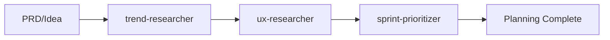
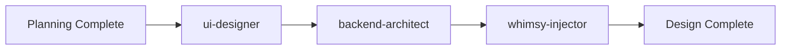
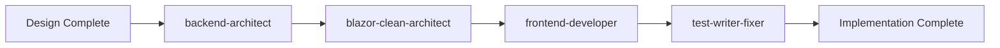
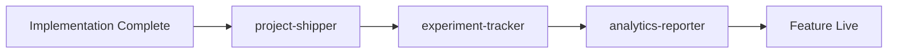

# Agent-Connected Coding Workflow

## Overview
This workflow enables rapid feature development from PRD to deployment using specialized agents that pass context and deliverables between each phase.

## 🎯 Core Workflow: PRD → UX → UI → Backend → Launch

### Phase 1: Planning & Research (Days 1-2)


**Agent Connections:**
- **trend-researcher** validates market demand, identifies viral potential
- **ux-researcher** studies user needs, creates journey maps
- **sprint-prioritizer** breaks features into 6-day deliverables

**Handoff Format:**
```json
{
  "feature_concept": "AI-powered estate planning wizard",
  "market_validation": {...},
  "user_research": {...},
  "sprint_plan": [...]
}
```

### Phase 2: Design & Architecture (Day 2-3)


**Agent Connections:**
- **ui-designer** creates MudBlazor component designs
- **backend-architect** designs CQRS commands/queries, Entity models
- **whimsy-injector** adds delightful micro-interactions

**Handoff Format:**
```json
{
  "ui_components": ["EstateWizardDialog.razor", "AssetSelector.razor"],
  "backend_contracts": {
    "commands": ["CreateEstateCommand"],
    "queries": ["GetEstateByIdQuery"],
    "entities": ["Estate", "Asset"]
  },
  "delight_moments": [...]
}
```

### Phase 3: Implementation (Days 3-5)


**Agent Connections:**
- **backend-architect** implements Domain/Application layers
- **blazor-clean-architect** creates Blazor components with Clean Architecture
- **frontend-developer** handles complex UI logic and state management
- **test-writer-fixer** ensures comprehensive test coverage

**Handoff Format:**
```json
{
  "domain_entities": ["src/Domain/Entities/Estate.cs"],
  "application_features": ["src/Application/Features/Estates/"],
  "ui_components": ["src/Server.UI/Pages/Estates/"],
  "test_coverage": "95%"
}
```

### Phase 4: Delivery & Launch (Day 6)


**Agent Connections:**
- **project-shipper** handles deployment, release notes, launch coordination
- **experiment-tracker** sets up A/B tests and feature flags
- **analytics-reporter** configures success metrics tracking

## 🔄 Agent Interaction Patterns

### 1. Sequential Handoffs
Each agent receives structured output from previous agent:
```
Agent A Output → Agent B Input → Agent B Output → Agent C Input
```

### 2. Parallel Collaboration
Multiple agents work simultaneously on different aspects:
```
Design Phase: ui-designer + backend-architect + whimsy-injector
```

### 3. Feedback Loops
Agents can request clarification or iteration:
```
test-writer-fixer → blazor-clean-architect (if tests fail)
ux-researcher → ui-designer (if usability issues found)
```

## 📋 Standard Input/Output Formats

### Agent Input Template
```json
{
  "context": {
    "previous_phase_output": {...},
    "project_structure": "Clean Architecture Blazor",
    "constraints": ["6-day sprint", "MudBlazor UI", "Clean Architecture"]
  },
  "requirements": [...],
  "success_criteria": [...]
}
```

### Agent Output Template
```json
{
  "deliverables": [...],
  "next_agent_instructions": "Specific guidance for next agent",
  "validation_criteria": [...],
  "dependencies": [...],
  "risks": [...]
}
```

## 🚀 Workflow Execution Commands

### Start New Feature
```bash
# Initialize workflow with PRD
claude-agent-workflow --start --input="PRD: AI estate planning wizard"
```

### Continue to Next Phase
```bash
# Move from planning to design
claude-agent-workflow --next-phase --context=planning_output.json
```

### Parallel Agent Execution
```bash
# Run design agents in parallel
claude-agent-workflow --parallel ui-designer,backend-architect,whimsy-injector
```

## 🎯 Success Metrics

- **Velocity**: Complete feature in 6 days
- **Quality**: 90%+ test coverage, zero critical bugs
- **User Experience**: Positive user feedback, adoption metrics
- **Technical Debt**: Maintain Clean Architecture principles

## 🔧 Integration Points

### With Existing Blazor Project
- Follows Clean Architecture patterns
- Uses MudBlazor component library
- Integrates with existing Entity Framework models
- Maintains CQRS + MediatR patterns

### With Development Tools
- Uses existing test frameworks
- Integrates with CI/CD pipeline
- Follows established code conventions
- Uses project's existing dependencies

## 📝 Example Workflow Execution

See `example-workflow-execution.md` for a complete walkthrough of building an "AI-powered document classification" feature using this agent workflow.