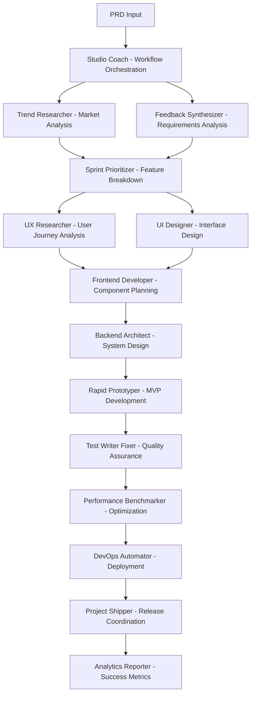

# AI-Powered Development Workflow
## From PRD to Production Using Agent Orchestration

This document outlines a comprehensive development workflow that leverages specialized AI agents to transform Product Requirements Documents (PRDs) into production-ready features for the Clean Architecture Blazor Server Application Portfolio System.

## Workflow Overview



## Phase 1: PRD Analysis & Strategic Planning

### Step 1: Initial Orchestration
**Agent**: Studio Coach
**Purpose**: Analyze the PRD and coordinate the entire workflow

```markdown
**Studio Coach Prompt:**
"We have a new PRD for our Application Portfolio System. I need you to:
1. Analyze the overall scope and complexity
2. Identify key stakeholders and success criteria
3. Set up the development sprint structure
4. Coordinate all other agents for optimal performance
5. Create a master timeline with dependencies"
```

### Step 2: Market & Trend Analysis
**Agent**: Trend Researcher
**Purpose**: Validate market fit and identify opportunities

```markdown
**Trend Researcher Prompt:**
"Research current market trends for [PRD feature area]. Analyze:
1. Similar solutions in the market
2. Emerging patterns and user behaviors
3. Technology trends that might impact implementation
4. Competitive advantages we can leverage
5. Market validation for the proposed features"
```

### Step 3: Requirements Synthesis
**Agent**: Feedback Synthesizer
**Purpose**: Transform PRD into actionable requirements

```markdown
**Feedback Synthesizer Prompt:**
"Analyze this PRD and extract:
1. Core functional requirements
2. Non-functional requirements (performance, security, scalability)
3. User personas and use cases
4. Success metrics and KPIs
5. Potential risks and mitigation strategies
6. Questions that need clarification from stakeholders"
```

## Phase 2: Feature Planning & Prioritization

### Step 4: Feature Breakdown & Sprint Planning
**Agent**: Sprint Prioritizer
**Purpose**: Break PRD into manageable features and prioritize for 6-day sprints

```markdown
**Sprint Prioritizer Prompt:**
"Based on the PRD analysis, break down the requirements into:
1. Epic-level features (major functionality areas)
2. User stories with acceptance criteria
3. 6-day sprint planning with dependencies
4. MVP vs future enhancement categorization
5. Risk assessment for each feature
6. Resource allocation recommendations"
```

## Phase 3: Research & Design Phase

### Step 5: User Experience Research
**Agent**: UX Researcher
**Purpose**: Design user journeys and validate design decisions

```markdown
**UX Researcher Prompt:**
"Design the user experience for [specific feature]. Include:
1. User journey maps for different personas
2. Pain point analysis and solutions
3. Accessibility requirements
4. Mobile vs desktop considerations
5. Integration points with existing application flows
6. Usability testing recommendations"
```

### Step 6: Interface Design
**Agent**: UI Designer
**Purpose**: Create visual designs following the MudBlazor design system

```markdown
**UI Designer Prompt:**
"Create UI designs for [feature] following our MudBlazor design system:
1. Wire frames for all key screens
2. Component specifications
3. Responsive design considerations
4. Design system adherence
5. Visual hierarchy and information architecture
6. Interactive element specifications"
```

### Step 7: Brand Consistency
**Agent**: Brand Guardian
**Purpose**: Ensure design aligns with application branding

```markdown
**Brand Guardian Prompt:**
"Review the proposed designs for [feature] and ensure:
1. Consistency with existing application branding
2. Proper use of color schemes and typography
3. Icon and imagery guidelines compliance
4. Voice and tone consistency in copy
5. Brand differentiation opportunities"
```

## Phase 4: Technical Planning

### Step 8: Frontend Architecture Planning
**Agent**: Frontend Developer
**Purpose**: Plan Blazor component architecture

```markdown
**Frontend Developer Prompt:**
"Plan the frontend implementation for [feature]:
1. Blazor component hierarchy and reusability
2. State management strategy
3. SignalR integration points for real-time updates
4. MudBlazor component usage and customization
5. Performance optimization strategies
6. Responsive design implementation"
```

### Step 9: Backend System Design
**Agent**: Backend Architect
**Purpose**: Design the backend architecture following Clean Architecture

```markdown
**Backend Architect Prompt:**
"Design the backend implementation for [feature] following our Clean Architecture:
1. Domain entities and value objects
2. Application layer CQRS handlers (Commands/Queries)
3. Database schema changes and migrations
4. Service interfaces and implementations
5. Security and permission requirements
6. Caching and performance considerations
7. Integration with existing services"
```

### Step 10: AI Integration Planning
**Agent**: AI Engineer
**Purpose**: Identify AI/ML opportunities

```markdown
**AI Engineer Prompt:**
"Analyze [feature] for AI/ML integration opportunities:
1. Areas where AI can enhance user experience
2. Recommendation systems potential
3. Predictive analytics opportunities
4. Natural language processing applications
5. Computer vision possibilities
6. Implementation complexity assessment"
```

## Phase 5: Rapid Prototyping

### Step 11: MVP Development
**Agent**: Rapid Prototyper
**Purpose**: Create functional prototype following 6-day sprint methodology

```markdown
**Rapid Prototyper Prompt:**
"Create a functional prototype for [feature] in 6 days or less:
1. Core functionality implementation
2. Database integration with proper Clean Architecture
3. Basic UI with MudBlazor components
4. Essential business logic
5. Minimal viable feature set
6. Integration points with existing system"
```

### Step 12: Mobile Optimization
**Agent**: Mobile App Builder
**Purpose**: Ensure mobile responsiveness and PWA features

```markdown
**Mobile App Builder Prompt:**
"Optimize [feature] for mobile experience:
1. Responsive design implementation
2. Touch-friendly interactions
3. PWA feature integration
4. Performance optimization for mobile
5. Offline capability assessment
6. Mobile-specific user flows"
```

## Phase 6: Quality Assurance & Testing

### Step 13: Comprehensive Testing
**Agent**: Test Writer Fixer
**Purpose**: Create and execute comprehensive test suite

```markdown
**Test Writer Fixer Prompt:**
"Create comprehensive tests for [feature]:
1. Unit tests for all business logic
2. Integration tests for CQRS handlers
3. Component tests for Blazor UI
4. End-to-end test scenarios
5. Security and permission testing
6. Performance baseline tests
7. Fix any test failures and optimize"
```

### Step 14: Performance Analysis
**Agent**: Performance Benchmarker
**Purpose**: Analyze and optimize performance

```markdown
**Performance Benchmarker Prompt:**
"Analyze performance of [feature]:
1. Database query optimization
2. Frontend rendering performance
3. API response times
4. Memory usage analysis
5. Concurrent user load testing
6. Caching effectiveness
7. Optimization recommendations"
```

### Step 15: API Testing
**Agent**: API Tester
**Purpose**: Comprehensive API validation

```markdown
**API Tester Prompt:**
"Test all APIs for [feature]:
1. Functional API testing
2. Load testing under various conditions
3. Security testing (authentication/authorization)
4. Error handling validation
5. API contract verification
6. Performance benchmarking"
```

## Phase 7: Code Review & Quality

### Step 16: Architecture Compliance
**Agent**: Blazor Clean Architect
**Purpose**: Ensure Clean Architecture compliance

```markdown
**Blazor Clean Architect Prompt:**
"Review [feature] implementation for Clean Architecture compliance:
1. Layer dependency validation
2. CQRS pattern adherence
3. Service interface implementation
4. Entity relationship correctness
5. Database context factory usage
6. Permission and security implementation"
```

### Step 17: Security Analysis
**Agent**: Legal Compliance Checker
**Purpose**: Security and compliance validation

```markdown
**Legal Compliance Checker Prompt:**
"Analyze [feature] for security and compliance:
1. GDPR compliance for data handling
2. Security vulnerabilities assessment
3. Permission system validation
4. Data encryption requirements
5. Audit trail completeness
6. Privacy policy implications"
```

## Phase 8: DevOps & Deployment

### Step 18: Infrastructure Setup
**Agent**: DevOps Automator
**Purpose**: Prepare deployment pipeline

```markdown
**DevOps Automator Prompt:**
"Set up deployment for [feature]:
1. CI/CD pipeline configuration
2. Database migration strategy
3. Environment configuration management
4. Monitoring and alerting setup
5. Rollback procedures
6. Performance monitoring integration"
```

### Step 19: Infrastructure Monitoring
**Agent**: Infrastructure Maintainer
**Purpose**: Monitor system health

```markdown
**Infrastructure Maintainer Prompt:**
"Set up monitoring for [feature]:
1. Application performance monitoring
2. Database performance tracking
3. Error rate monitoring
4. User experience metrics
5. Resource utilization tracking
6. Alert configuration"
```

## Phase 9: Release & Marketing

### Step 20: Release Coordination
**Agent**: Project Shipper
**Purpose**: Coordinate feature release

```markdown
**Project Shipper Prompt:**
"Coordinate the release of [feature]:
1. Release timeline and dependencies
2. Stakeholder communication plan
3. User documentation preparation
4. Training material creation
5. Release notes and changelog
6. Post-release monitoring plan"
```

### Step 21: TikTok Marketing Strategy
**Agent**: TikTok Strategist
**Purpose**: Create viral marketing content

```markdown
**TikTok Strategist Prompt:**
"Create TikTok marketing strategy for [feature]:
1. Feature demonstration videos
2. User testimonial concepts
3. Behind-the-scenes development content
4. Trending hashtag opportunities
5. Influencer collaboration ideas
6. User-generated content campaigns"
```

### Step 22: App Store Optimization
**Agent**: App Store Optimizer
**Purpose**: Optimize for app store visibility

```markdown
**App Store Optimizer Prompt:**
"Optimize [feature] for app store visibility:
1. Feature highlight in app description
2. Screenshot and video content
3. Keyword optimization
4. Review response strategy
5. Feature announcement timing
6. Competitive positioning"
```

## Phase 10: Analytics & Iteration

### Step 23: Success Metrics Analysis
**Agent**: Analytics Reporter
**Purpose**: Measure feature success

```markdown
**Analytics Reporter Prompt:**
"Analyze [feature] performance and success:
1. User adoption metrics
2. Feature usage patterns
3. Performance benchmarks vs targets
4. User satisfaction scores
5. Business impact assessment
6. Recommendations for iteration"
```

### Step 24: Experiment Tracking
**Agent**: Experiment Tracker
**Purpose**: A/B test and iterate

```markdown
**Experiment Tracker Prompt:**
"Set up experiments for [feature] optimization:
1. A/B test design for key features
2. User behavior tracking
3. Conversion funnel analysis
4. Feature flag management
5. Statistical significance monitoring
6. Iteration recommendations"
```

### Step 25: Financial Analysis
**Agent**: Finance Tracker
**Purpose**: ROI and cost analysis

```markdown
**Finance Tracker Prompt:**
"Analyze financial impact of [feature]:
1. Development cost vs budget
2. ROI projections and actuals
3. Resource utilization efficiency
4. Revenue impact assessment
5. Cost optimization opportunities
6. Future investment recommendations"
```

## Workflow Execution Example

Here's how you would initiate this workflow with a PRD:

```markdown
I have a PRD for a new "AI-Powered Estate Planning Assistant" feature. Please execute the complete development workflow:

**PRD Summary:**
- Add AI-powered recommendations for estate planning
- Integration with existing estate document management
- Natural language interface for document generation
- Automated beneficiary optimization suggestions
- Integration with external legal databases

**Expected Outcome:**
- Complete feature implementation following Clean Architecture
- Comprehensive testing and quality assurance
- Performance-optimized and mobile-ready
- Ready for production deployment
- Marketing materials and success metrics tracking
```

## Agent Coordination Protocols

### Communication Flow
1. **Studio Coach** orchestrates all agents and maintains overall timeline
2. **Sequential Dependencies**: Some agents must complete before others can start
3. **Parallel Execution**: Multiple agents can work simultaneously on independent tasks
4. **Feedback Loops**: Agents can request clarification or additional research
5. **Quality Gates**: Each phase has defined success criteria before proceeding

### Error Handling
- If an agent encounters blockers, **Studio Coach** reassigns or provides additional context
- Failed implementations trigger **Test Writer Fixer** for debugging
- Performance issues escalate to **Performance Benchmarker**
- Architecture violations trigger **Blazor Clean Architect** for remediation

### Success Criteria
Each phase has defined deliverables and quality gates:
- ✅ Requirements are clear and actionable
- ✅ Designs are approved and implementable
- ✅ Code passes all tests and performance benchmarks
- ✅ Architecture compliance is verified
- ✅ Security and legal requirements are met
- ✅ Deployment is successful with monitoring in place
- ✅ Success metrics show positive user impact

This workflow ensures comprehensive, high-quality feature development while maintaining architectural integrity and maximizing user value.